<p align="center">
  
</p>

<p align="center">
  <b>Neovim, fully set up, without Lua, plugin managers or dependencies.</b><br>
  AstroNvim's keymaps, look and workflow built in: one ~1 MB Rust binary, nothing to install, configure or
  keep in sync, and nothing that breaks after an update.
</p>

<p align="center">
  <a href="#install">Install</a> ·
  <a href="docs/keymaps.md">Keymaps</a> ·
  <a href="docs/configuration.md">Configuration</a> ·
  <a href="docs/themes.md">Themes</a> ·
  <a href="docs/development.md">Development</a>
</p>

---

## Why lim

You want Neovim the way AstroNvim sets it up: the file tree, fuzzy finder, which-key, git signs, statusline,
themes, completion. Getting there means Lua config, a plugin manager, dozens of plugins, their dependencies
(ripgrep, fd, a C compiler for treesitter, Node for some servers), and a setup that breaks when one of them
updates.

lim is that editor with all of it **built in**:

- **No Lua.** One JSON file for options, colors and keymaps, or the `<Leader>,` settings screen.
- **No plugins.** File tree, pickers, live grep, which-key, git signs, completion, sessions, 30 themes,
  text tools: part of the binary, tested together. `<Leader>pu` gets the latest release.
- **No dependencies.** Nothing to install beside the binary, not even git; it runs the same on Linux, macOS
  and Windows.
- **Nothing breaks after an update.** There is no ecosystem to drift out of sync.
- **Vim inside.** Operators, text objects, registers, macros, marks, regex `:s` and `:g`, `:norm`, visual
  block: your muscle memory works.
- **A hex editor for reverse engineering.** Binaries open as an editable hex dump; `:detect`, `:strings`,
  `:inspect`, `:pack`, `:xor` and the encodings (`:base64`, `:hex`, `:url`…) need no other tool.
- **Still extensible.** [Commands](docs/commands.md) in the config pipe text through any program you like
  (format on save, git), without an embedded language to learn.

**The symbol.** lim's emblem is the Lernaean Hydra, the many-headed serpent of the lake (λίμνη, *limnē*)
of Lerna: one body, many heads, like one editor working many windows. It greets you, in braille, on
the start screen.

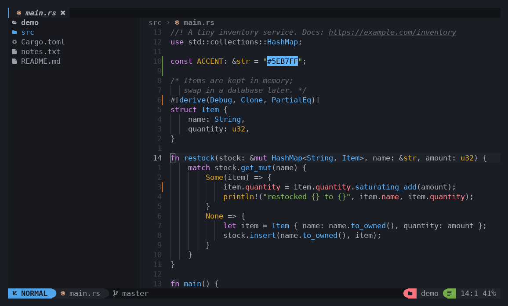

| **Start screen** (the hydra and nvdash's buttons) | **Find files** (with preview) |
|---|---|
| 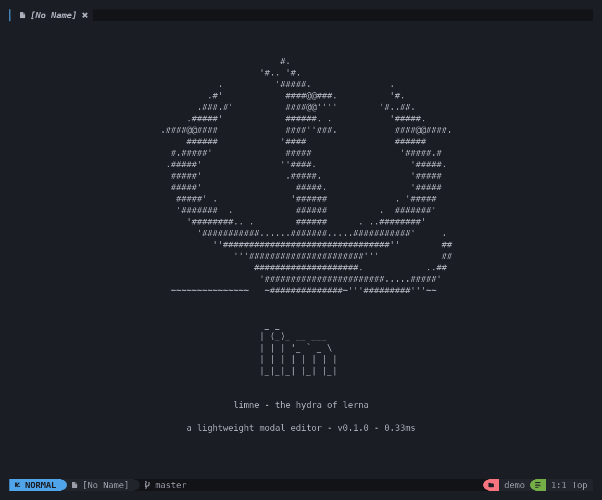 | 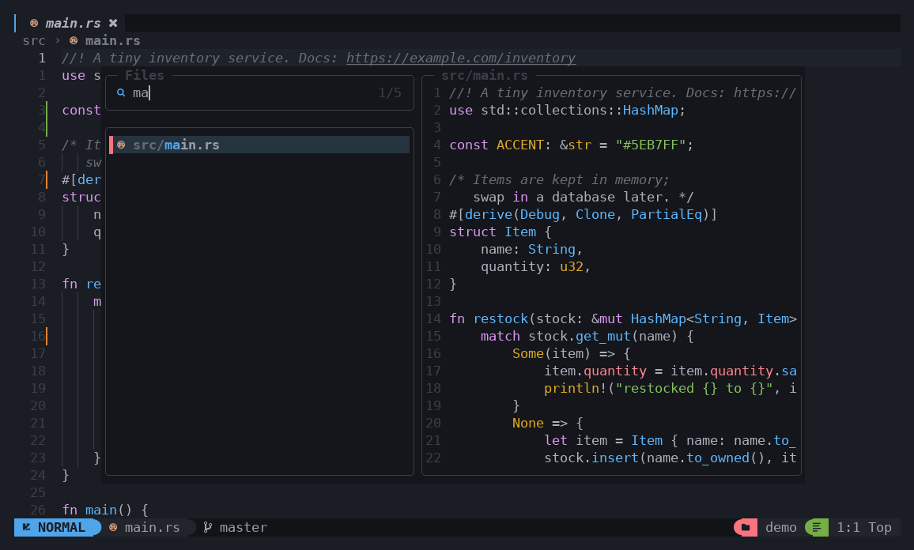 |
| **Live grep** | **which-key** (`<Leader>`) |
| 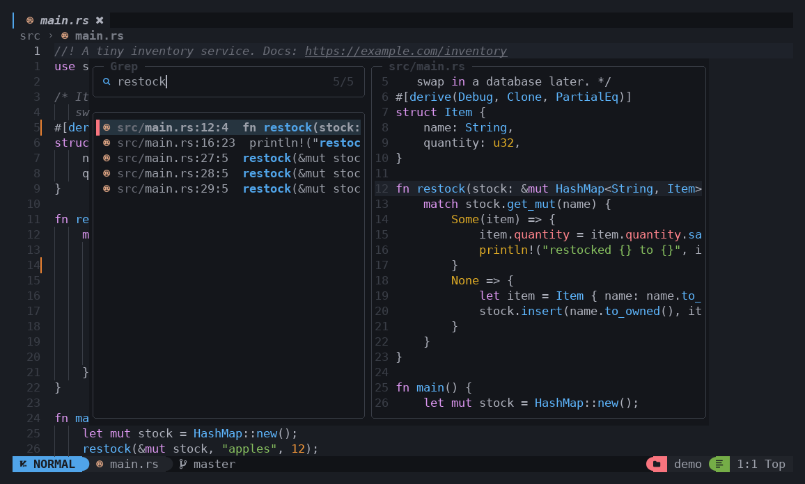 | 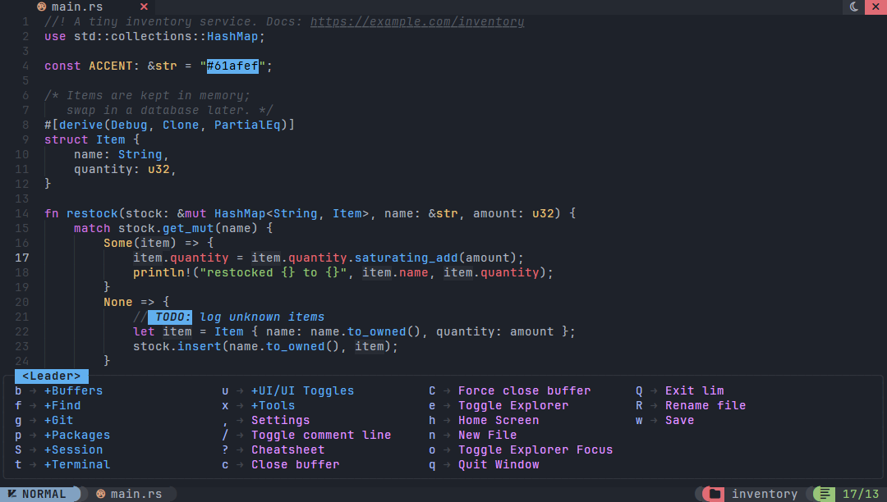 |
| **Cheat sheet** (`<F1>`) | **Theme switcher** (`<Leader>ft`, live on a code sample) |
| 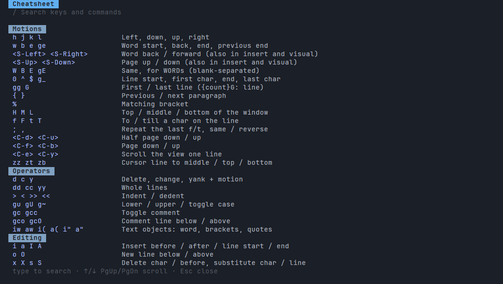 | 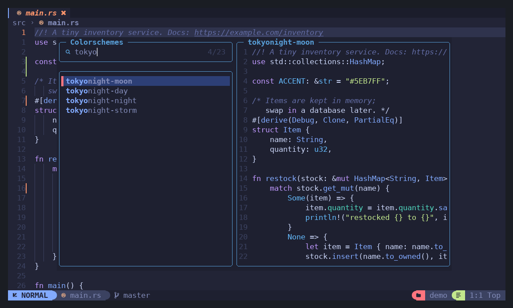 |
| **Completion** (words from open buffers) | **Command-line completion** |
| 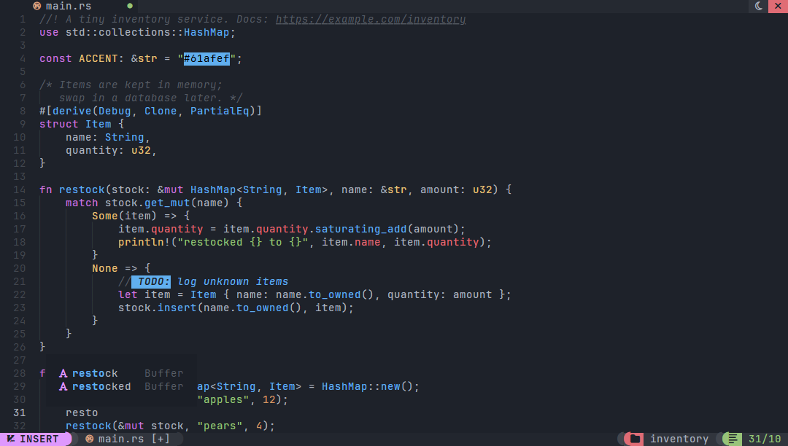 | 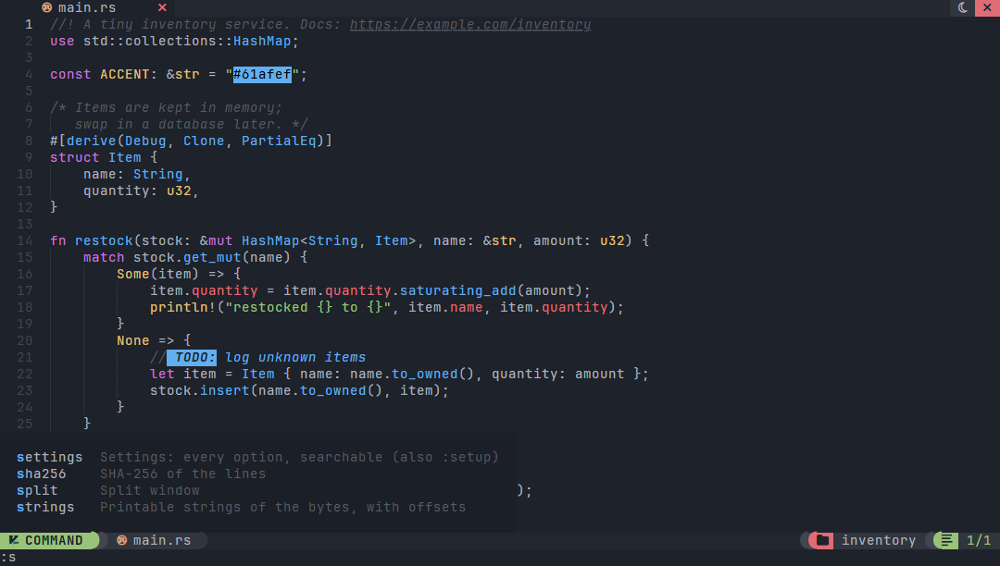 |
| **Tools** (`<Leader>xc`, a popup that keeps its history) | **Visual line selection** |
| 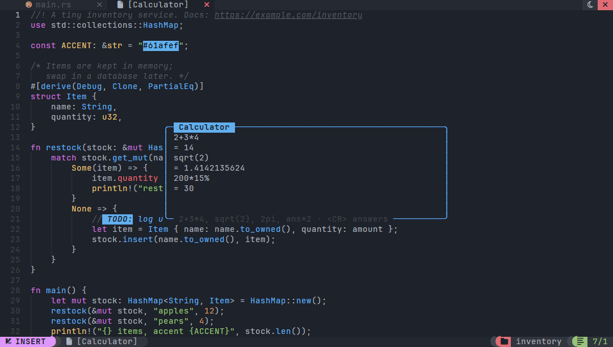 | 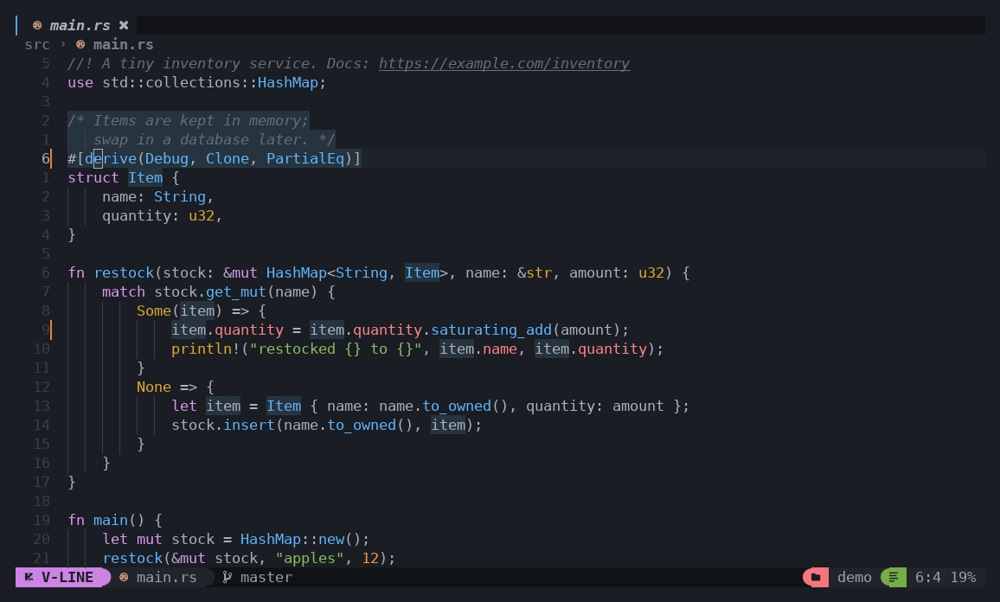 |
| **Settings** (`<Leader>,`, every option, searchable) | |
| 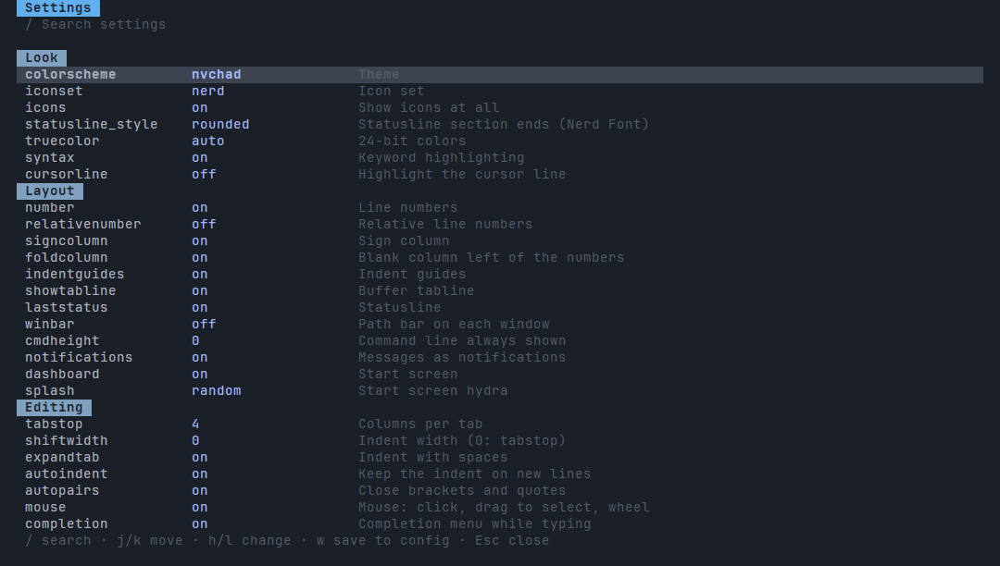 | |

## Features

| Area | What you get |
|---|---|
| Vim editing | Normal, insert, replace, visual, visual-line and visual-block modes · counts · operators `d c y > < gu gU g~ gc` over any motion or text object · `.` · macros · undo/redo (1000 levels) · named registers (`"a`, `"A` append, `"0`, `"1`–`"9` shifting, `"-`, `"_`, `"+`) · marks and jump list that follow edits · Vim regexes in `/`, `?`, `*`, `:s`, `:g` · `:g`/`:v`, `:norm`, `:sort`, `:m`, `:t`, `:r` · line ranges with offsets |
| Motions | `h j k l w b e ge W B E gE 0 ^ $ g_ { } % gg G H M L f F t T ; , n N * #`, `gn` (`cgn` then `.`), page and line scrolling, `<S-arrows>` (word / page), `zz zt zb` · `:` and `/` history |
| Text objects | `iw` `aw` `iW` `aW` `ip` `ap` `it` `at` (HTML/XML tags) `i(` `a(` `i[` `a[` `i{` `a{` `i<` `a<` `i"` `a"` `i'` `a'` `` i` `` `` a` `` |
| NvChad look | 30 colorschemes (NvChad's onedark by default) · NvChad-style statusline (rounded, slanted, arrow or flat ends) · NvChad tabufline with jump labels and clickable tabs, close marks, light/dark and close-all buttons, aligned with the windows when the file tree is open · git branch and +/~/- counts in the statusline, and a hydra spinner while background commands (`:upgrade`, config commands) run · nvim-tree look for the file tree · optional winbar path and relative numbers · sign column · cursor line number (or the whole cursorline) · borderless NvChad-style floats with pill titles · notifications · start screen with the hydra and nvdash buttons |
| Code | syntax highlighting with Sublime grammars (syntect, bat's set) for 200+ languages and formats (Rust, Python, JS/TS, C/C++, C#, Java, Kotlin, Go, PHP, Ruby, Swift, Dart, Scala, Lua, SQL, HTML/XML, CSS/SCSS, Markdown, JSON/YAML/TOML, shell, batch, Makefile, Dockerfile, CMake, Zig, Haskell, Elixir, R, Perl, asm, Nix, Terraform...) · blink.cmp-style completion from the words of open buffers · autopairs · auto-indent · comment toggling |
| Helpers | indent guides · matching bracket · references of the word under the cursor (`]r`) · URLs (`gx`) · `#RRGGBB` shown in its color · `TODO:`/`FIX:`/`HACK:`… highlighted (`]T`) · Markdown preview beside the file, live as you type (`<Leader>um`) |
| Git | signs against the index · hunk jumps · graph of every branch, log, file log, status and stash pickers with diffs · `git browse` · status colors in the file tree |
| Files | fuzzy picker with preview (files, git files, grep, buffers, recent, smart, lines, marks, registers, notifications, keymaps, commands, TODOs, sessions) · neo-tree style explorer with create/rename/copy/move/delete · `:rename` · sessions |
| Windows | `|` / `` splits, `<C-h/j/k/l>`, `<C-arrows>` to resize, `<C-w>` family, zen mode, global statusline · mouse: click to place the cursor or focus a window, click a tab or a tabline button, drag to select, wheel to scroll text and lists |\|` / `\` splits, `<C-h/j/k/l>`, `<C-arrows>` to resize, `<C-w>` family, zen mode, global statusline · mouse: click to place the cursor or focus a window, drag to select, wheel to scroll text and lists |
| System | system clipboard (`clipboard=unnamedplus`, OSC 52 fallback over SSH) · `<F7>` shell, node, python, btm, gdu |
| Config | settings screen (`<Leader>,`) to search and change every option live and save it · one JSON file: Neovim option names, colorscheme, astrotheme palette, Neovim highlight groups, keymaps per mode, icon set |
| Text tools | `:uniq` `:base64[!]` `:base32[!]` `:hex[!]` `:url[!]` `:rot13` `:sha256` `:wc` `:calc` `:case` `:json[!]` on the buffer or a range, built in (no process) |
| Tools (`<Leader>x`) | tool popups that keep their history (`<CR>` answers a line, again after an edit): calculator (functions, bases, `ans`) · unit converter (length, area, volume, mass, time, speed, temperature, data, energy, power, pressure, angle) · number bases · timestamps and date differences · colors (hex, rgb, hsl) · word case · insert date, UUID, password, lorem ipsum · JSON format/minify · word count |
| Hex & RE | binary files open as an editable hex dump, written back as bytes · `:hexedit` · `:detect` (ELF/PE/Mach-O and 20 formats, architecture, entropy, UPX) · `:strings` · `:inspect` · `:pack` · `:xor` |
| Commands | `:Commands` in the config pipe the lines through a program in any language and put its output back or show it · format on save |
| Robustness | atomic saves · refuses to clobber other files · a broken hex dump is never written · files too big for memory are refused, not half-loaded · internal errors are caught, the session goes on and unsaved buffers are backed up · `unwrap`/`panic!` denied by lints |
| Updates | `<Leader>pu` or `:upgrade` downloads the latest GitHub release's binary and swaps it in, from inside the editor |

## Install

One line. The installer builds the latest release from source with Rust 1.88+ ([rustup](https://rustup.rs); on Windows with the
MSVC build tools it offers) and puts it in `~/.cargo/bin`, which rustup already adds to your `PATH`.

**Linux, macOS**

```sh
curl -fsSL https://raw.githubusercontent.com/Neotoxic-off/Lim/master/install.sh | sh
```

**Windows** (cmd)

```bat
curl -fsSLo %TEMP%\lim-install.bat https://raw.githubusercontent.com/Neotoxic-off/Lim/master/install.bat && %TEMP%\lim-install.bat
```

**Windows** (PowerShell)

```powershell
curl.exe -fsSLo $env:TEMP\lim-install.bat https://raw.githubusercontent.com/Neotoxic-off/Lim/master/install.bat; & $env:TEMP\lim-install.bat
```

**Update** from inside lim with `<Leader>pu` (or `:upgrade`): it asks GitHub for the latest release and, when it is
newer than yours, downloads the binary for your platform and puts it in place of the running one, in the background
while you keep editing. No Rust or curl needed: lim talks HTTPS itself (rustls, HTTPS only, the proxy from
`HTTPS_PROXY` or Windows' settings). A notification says when it is done; restart lim to use the new version. Release binaries exist for Linux
x86_64 and ARM64, macOS (Apple silicon and Intel) and Windows x86_64; elsewhere, run the installer again.

Without the installer: `cargo install --git https://github.com/Neotoxic-off/Lim --locked`, or from a clone
`cargo build --release` and copy `target/release/lim` (`lim.exe`) onto your `PATH`.

Runs on Linux, macOS and Windows 10+ (Windows Terminal or the console, not mintty). A
[Nerd Font](https://www.nerdfonts.com) for the default icons; without one installed, lim starts with
`"iconset": "unicode"` (or set `"ascii"`). Truecolor is
detected; other terminals get the 256-color palette.

Optional, picked up when installed: `node`, `python3`, `btm`, `gdu`, and the TUI tools of `<Leader>t…`.

## Usage

```sh
lim                    # start screen
lim src/main.rs a.lua  # open files
lim ../project         # work in that folder (explorer, finder, git, sessions)
lim app.exe            # a binary opens as a hex dump
lim --print-config     # the documented default config
lim --config-path      # where lim looks for config.json
lim --help | --version
```

Messages appear as notifications in the top-right corner (`cmdheight = 0`, as in AstroNvim); `:` and `/`
borrow a line while you type, pushing the statusline up as Neovim does. Press `<F1>` for the cheat sheet (type to
search every key and command), or `<Space>` and wait for which-key.

## Documentation

| Page | Covers |
|---|---|
| [Keymaps](docs/keymaps.md) | Leader keys: buffers, windows, find, git, file tree, sessions, UI toggles |
| [Vim editing](docs/vim.md) | Vim keys, completion, Ex commands, text tools, regex patterns |
| [Tools](docs/tools.md) | Calculator, unit converter, bases, time, color and the other `<Leader>x` tools |
| [Themes and icons](docs/themes.md) | The 30 colorschemes, icon sets, statusline styles and start screens |
| [Configuration](docs/configuration.md) | Config file, options, palette, highlight groups, keymaps |
| [Commands](docs/commands.md) | `:Name` commands through external programs, format on save |
| [Hex editing](docs/hex.md) | Hex dumps and the reverse-engineering commands |
| [How lim is built](docs/architecture.md) | Code layout and design |
| [Development](docs/development.md) | Building, testing, fuzzing, benchmarks against Neovim |

## Limits

Not there, by design: LSP (`<Leader>l…`, `gd`, diagnostics, language-aware completion; buffer-word completion is there), debugger, treesitter (syntect
grammars stand in), plugins, scripting the editor (config commands only filter text through a process), an
embedded terminal (`<F7>` suspends to your shell), Vim tab pages,
line wrapping, folds, spell checking, persistent undo. Files are read whole into memory, as in Vim: text files
over 512 MB and binaries over 64 MB (their hex dump takes about 7 times their size) are refused with a message.
There is no disassembler.

## License

[MIT](LICENSE).
