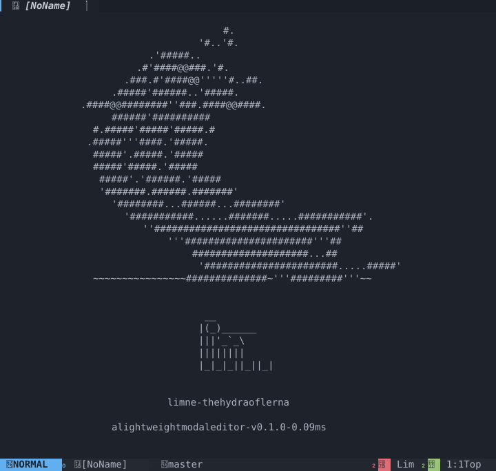
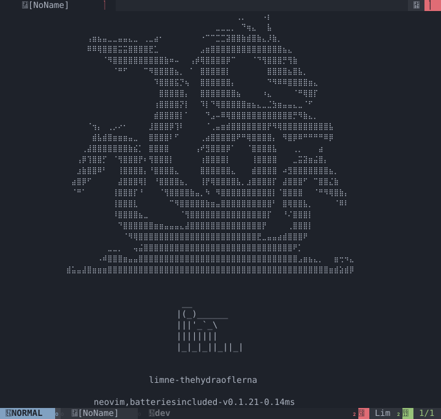
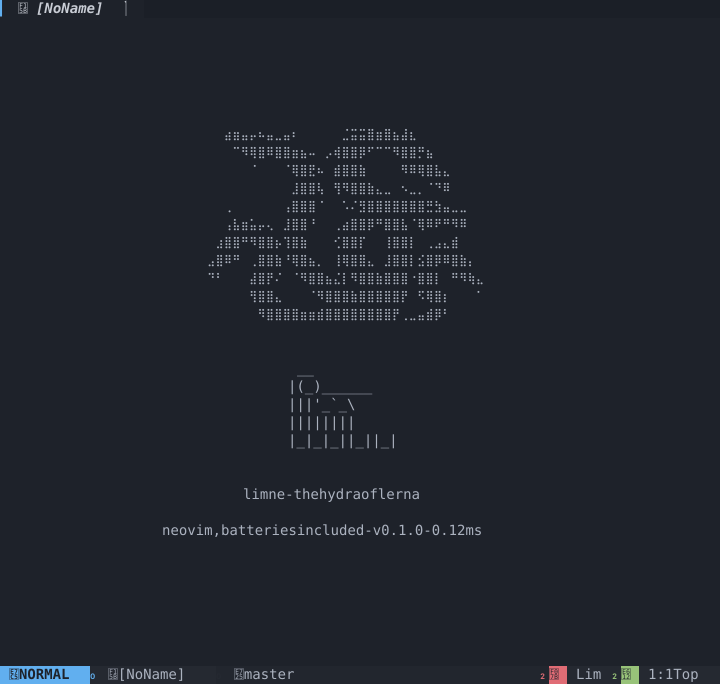

<p align="center">
  
</p>

<p align="center">
  <b>Neovim, fully set up, without Lua, plugin managers or dependencies.</b><br>
  AstroNvim's keymaps, look and workflow built in: one ~1 MB Rust binary, nothing to install, configure or
  keep in sync, and nothing that breaks after an update.
</p>

---

## Why lim

You want Neovim the way AstroNvim sets it up: the file tree, fuzzy finder, which-key, git signs, statusline,
themes, completion. Getting there means Lua config, a plugin manager, dozens of plugins, their dependencies
(ripgrep, fd, a C compiler for treesitter, Node for some servers), and a setup that breaks when one of them
updates.

lim is that editor with all of it **built in**:

- **No Lua.** One JSON file for options, colors and keymaps, or the `<Leader>,` settings screen.
- **No plugins.** File tree, pickers, live grep, which-key, git signs, completion, sessions, 30 themes,
  text tools: part of the binary, tested together. `lim --update` gets the latest release.
- **No dependencies.** Zero crates, nothing to install beside the binary; it runs the same on Linux, macOS
  and Windows.
- **Nothing breaks after an update.** There is no ecosystem to drift out of sync.
- **Vim inside.** Operators, text objects, registers, macros, marks, regex `:s` and `:g`, `:norm`, visual
  block: your muscle memory works.
- **A hex editor for reverse engineering.** Binaries open as an editable hex dump; `:detect`, `:strings`,
  `:inspect`, `:pack`, `:xor` and the encodings (`:base64`, `:hex`, `:url`…) need no other tool.
- **Still extensible.** [Commands](#commands) in the config pipe text through any program you like
  (format on save, git), without an embedded language to learn.

**The symbol.** lim's emblem is the Lernaean Hydra, the many-headed serpent of the lake (λίμνη, *limnē*)
of Lerna: one body, many heads, like one editor working many windows. It greets you, in plain ASCII, on
the start screen.


| Start screen | Find files |
|---|---|
|  |  |
| **Grep** | **which-key over two splits** |
|  |  |
| **Cheat sheet** (`<F1>`) | **Theme switcher** (`<Leader>ft`, live preview) |
|  |  |
| **Completion** (words from open buffers) | **Command-line completion** (tabs aligned with the windows) |
|  |  |

## Contents

- [Why lim](#why-lim)
- [Features](#features)
- [Install](#install)
- [Usage](#usage)
- [Keymaps](#keymaps)
- [Tools](#tools)
- [Themes and icons](#themes-and-icons)
- [Configuration](#configuration)
- [Hex editing and reverse engineering](#hex-editing-and-reverse-engineering)
- [Commands](#commands)
- [How it is built](#how-it-is-built)
- [Limits](#limits)
- [Development](#development)

## Features

| Area | What you get |
|---|---|
| Vim editing | Normal, insert, replace, visual, visual-line and visual-block modes · counts · operators `d c y > < gu gU g~ gc` over any motion or text object · `.` · macros · undo/redo (1000 levels) · named registers (`"a`, `"A` append, `"0`, `"1`–`"9` shifting, `"-`, `"_`, `"+`) · marks and jump list that follow edits · Vim regexes in `/`, `?`, `*`, `:s`, `:g` · `:g`/`:v`, `:norm`, `:sort`, `:m`, `:t`, `:r` · line ranges with offsets |
| Motions | `h j k l w b e ge W B E gE 0 ^ $ g_ { } % gg G H M L f F t T ; , n N * #`, `gn` (`cgn` then `.`), page and line scrolling, `<S-arrows>` (word / page), `zz zt zb` · `:` and `/` history |
| Text objects | `iw` `aw` `iW` `aW` `ip` `ap` `it` `at` (HTML/XML tags) `i(` `a(` `i[` `a[` `i{` `a{` `i<` `a<` `i"` `a"` `i'` `a'` `` i` `` `` a` `` |
| AstroNvim look | 30 colorschemes (NvChad's onedark by default) · NvChad-style statusline (rounded, slanted, arrow or flat ends) · buffer tabline with jump labels, aligned with the windows when the file tree is open · winbar path · relative numbers · sign column · cursorline · borderless NvChad-style floats with pill titles · notifications · start screen |
| Code | keyword highlighting for 40+ languages and formats (Rust, Python, JS/TS, C/C++, C#, Java, Kotlin, Go, PHP, Ruby, Swift, Dart, Scala, Lua, SQL, HTML/XML, CSS/SCSS, Markdown, JSON/YAML/TOML, shell, PowerShell, batch, Makefile, Dockerfile, CMake, Zig, Haskell, Elixir, R, Perl, asm, Nix, Terraform...) with multi-line comments and strings, HTML tags and config keys · blink.cmp-style completion from the words of open buffers · autopairs · auto-indent · comment toggling |
| Helpers | indent guides · matching bracket · references of the word under the cursor (`]r`) · URLs (`gx`) · `#RRGGBB` shown in its color · `TODO:`/`FIX:`/`HACK:`… highlighted (`]T`) · Markdown preview beside the file, live as you type (`<Leader>um`) |
| Git | signs against the index · hunk jumps · graph of every branch, log, file log, status and stash pickers with diffs · `git browse` · status colors in the file tree |
| Files | fuzzy picker with preview (files, git files, grep, buffers, recent, smart, lines, marks, registers, notifications, keymaps, commands, TODOs, sessions) · neo-tree style explorer with create/rename/copy/move/delete · `:rename` · sessions |
| Windows | `\|` / `\` splits, `<C-h/j/k/l>`, `<C-arrows>` to resize, `<C-w>` family, zen mode, global statusline · mouse: click to place the cursor or focus a window, drag to select, wheel to scroll text and lists |
| System | system clipboard (`clipboard=unnamedplus`, OSC 52 fallback over SSH) · `<F7>` shell, node, python, btm, gdu |
| Config | settings screen (`<Leader>,`) to search and change every option live and save it · one JSON file: Neovim option names, colorscheme, astrotheme palette, Neovim highlight groups, keymaps per mode, icon set |
| Text tools | `:uniq` `:base64[!]` `:base32[!]` `:hex[!]` `:url[!]` `:rot13` `:sha256` `:wc` `:calc` `:case` `:json[!]` on the buffer or a range, built in (no process) |
| Tools (`<Leader>x`) | tool windows that keep their history (`<CR>` answers a line, again after an edit): calculator (functions, bases, `ans`) · unit converter (length, area, volume, mass, time, speed, temperature, data, energy, power, pressure, angle) · number bases · timestamps and date differences · colors (hex, rgb, hsl) · word case · insert date, UUID, password, lorem ipsum · JSON format/minify · word count |
| Hex & RE | binary files open as an editable hex dump, written back as bytes · `:hexedit` · `:detect` (ELF/PE/Mach-O and 20 formats, architecture, entropy, UPX) · `:strings` · `:inspect` · `:pack` · `:xor` |
| Commands | `:Commands` in the config pipe the lines through a program in any language and put its output back or show it · format on save |
| Robustness | atomic saves · refuses to clobber other files · a broken hex dump is never written · files too big for memory are refused, not half-loaded · internal errors are caught, the session goes on and unsaved buffers are backed up · `unwrap`/`panic!` denied by lints |
| Updates | `lim --update` checks the latest GitHub release and rebuilds lim from it |

## Install

One line. The installer builds lim from source with Rust 1.88+ ([rustup](https://rustup.rs); on Windows with the
MSVC build tools it offers) and puts it in `~/.cargo/bin`, which rustup already adds to your `PATH`.

**Linux, macOS**

```sh
curl -fsSL https://raw.githubusercontent.com/Neotoxic-off/Lim/master/install.sh | sh
```

**Windows** (cmd)

```bat
curl -fsSLo %TEMP%\lim-install.bat https://raw.githubusercontent.com/Neotoxic-off/Lim/master/install.bat && %TEMP%\lim-install.bat
```

**Windows** (PowerShell)

```powershell
curl.exe -fsSLo $env:TEMP\lim-install.bat https://raw.githubusercontent.com/Neotoxic-off/Lim/master/install.bat; & $env:TEMP\lim-install.bat
```

**Update** with `lim --update`: it asks GitHub for the latest release and, when it is newer than yours, rebuilds
lim from that tag with cargo (it needs `curl`, present on Linux, macOS and Windows 10+); otherwise it says you are
up to date. Running the installer again also updates.

Without the installer: `cargo install --git https://github.com/Neotoxic-off/Lim --locked`, or from a clone
`cargo build --release` and copy `target/release/lim` (`lim.exe`) onto your `PATH`.

Runs on Linux, macOS and Windows 10+ (Windows Terminal or the console, not mintty). A
[Nerd Font](https://www.nerdfonts.com) for the default icons (or `"iconset": "unicode"` / `"ascii"`). Truecolor is
detected; other terminals get the 256-color palette.

Optional, picked up when installed: `wl-copy`/`xclip`/`xsel`/`pbcopy` (clipboard; Windows uses its own),
`node`, `python3`, `btm`, `gdu`, `xdg-open`/`open` (`gx`, `<Leader>go`; Windows uses `explorer`).

## Usage

```sh
lim                    # start screen
lim src/main.rs a.lua  # open files
lim ../project         # work in that folder (explorer, finder, git, sessions)
lim app.exe            # a binary opens as a hex dump
lim --update           # update to the latest GitHub release
lim --print-config     # the documented default config
lim --config-path      # where lim looks for config.json
lim --help | --version
```

Messages appear as notifications in the top-right corner (`cmdheight = 0`, as in AstroNvim); `:` and `/`
borrow a line while you type, pushing the statusline up as Neovim does.

The `:` line completes as you type: command names, then file paths for `:e`, `:w`, `:sp`,
`:vs`. `<Tab>`/`<C-n>` and `<S-Tab>`/`<C-p>`
cycle through the menu, writing the choice into the line; `<CR>` runs it. Press `<F1>` (or `<Leader>fh`, `:help`)
for the cheat sheet, laid out as the settings screen: type to search every key and command, arrows to scroll. Or
press `<Space>` and wait for which-key.

## Keymaps

The leader is `<Space>`. Unless marked *lim*, everything matches AstroNvim's defaults, plus the
`<Tab>`/`<S-Tab>` buffer navigation of the reference config.

### General

| Keys | Action |
|---|---|
| `<Leader>w` · `<C-s>` | Save · force write |
| `<Leader>q` · `<Leader>Q` · `<C-q>` | Quit window · exit · force quit |
| `<Leader>n` | New file |
| `<Leader>R` | Rename file |
| `<Leader>/` (normal, visual) · `gc{motion}` · `gcc` | Toggle comment |
| `gco` · `gcO` | Add a comment line below / above |
| `<Leader>h` | Home screen |
| `<F1>` · `<Leader>fh` · `<Leader>?` | Cheat sheet (*lim*) |
| `<Leader>,` | Settings: theme, icons, every option (*lim*) |

### Buffers

| Keys | Action |
|---|---|
| `<Tab>` `<S-Tab>` · `]b` `[b` | Next / previous buffer |
| `>b` `<b` | Move buffer tab right / left |
| `<Leader>c` · `<Leader>C` | Close · force close buffer |
| `<Leader>bb` · `<Leader>bd` | Pick a buffer by its tabline label to open / close |
| `<Leader>b\|` · `<Leader>b\` | Pick a buffer into a vertical / horizontal split |
| `<Leader>bc` · `bC` · `bl` · `br` | Close others · all · to the left · to the right |
| `<Leader>bp` | Previous buffer |
| `<Leader>bse` `bsr` `bsp` `bsi` `bsm` | Sort by extension · relative path · full path · number · modification |

### Windows

| Keys | Action |
|---|---|
| `\|` · `\` | Vertical · horizontal split |
| `<C-h>` `<C-j>` `<C-k>` `<C-l>` | Move between windows (and into the file tree) |
| `<C-Up>` `<C-Down>` `<C-Left>` `<C-Right>` | Resize the split |
| `<C-w>v` `s` `c` `q` `o` `w` `h` `j` `k` `l`, `<C-w><arrows>` | Vim window commands |

### Find

| Keys | Action |
|---|---|
| `<Leader>ff` · `fF` · `fg` | Files · all files · git files |
| `<Leader>fw` · `fW` · `fc` | Grep · grep in all files · grep the word under the cursor |
| `<Leader>fb` · `fo` · `fO` · `fs` | Buffers · old files · old files in this directory · buffers/recent/files |
| `<Leader>fl` · `f'` · `fr` · `fn` | Lines · marks · registers · notifications |
| `<Leader>fk` · `fC` · `fT` | Keymaps · commands · TODO comments |
| `<Leader>ft` · `fI` · `fa` | Colorschemes (live preview) · icon sets (*lim*) · lim config files |
| `<Leader>f<CR>` | Resume the last search |

Inside a picker: type to filter, `<C-n>`/`<C-p>` (or arrows, `<C-j>`/`<C-k>`) to move, `<CR>` to open,
`<C-v>`/`<C-s>` to open in a vertical/horizontal split, `<Esc>` to close.

### Git

| Keys | Action |
|---|---|
| `]g` `[g` · `]G` `[G` | Next / previous hunk · last / first hunk |
| `<Leader>gg` | Graph of every branch (`git log --graph --all`); `<CR>` on a commit shows it |
| `<Leader>gc` · `gC` · `gt` · `gT` | Log · log of this file · status · stash |
| `<Leader>go` | Open the file and line on the git host |

### File tree

`<Leader>e` toggles it, `<Leader>o` moves the focus in and out. Inside, as in neo-tree:

| Keys | Action |
|---|---|
| `j` `k` · `<CR>` `l` `o` · `h` | Move · open file or fold directory · close directory / go to parent |
| `a` · `A` · `r` · `d` | Add file (`name/` for a directory) · add directory · rename · delete (asks) |
| `c` · `m` · `y` · `Y` | Copy · move · copy name · copy path |
| `s` · `S` · `P` · `O` | Open in vertical / horizontal split · preview · open with the system |
| `.` · `<BS>` · `H` · `R` | Make root · root up · show hidden · refresh |
| `q` · `<C-l>` `<Esc>` · `?` | Close · back to the file · cheat sheet |

### Terminal and tools

`<F7>`, `<Leader>tf`, `<Leader>th`, `<Leader>tv` suspend lim and open your `$SHELL` (`%COMSPEC%` on Windows; `exit` comes back);
`<Leader>tn` node, `<Leader>tp` python, `<Leader>tt` btm, `<Leader>tu` gdu.
Files changed meanwhile are reloaded. *lim*: there is no embedded terminal.

### Sessions

`<Leader>Sl` last session · `Ss` save (named) · `SS` save for this directory · `S.` load this directory's ·
`Sf` / `SF` pick a session / directory session · `Sd` / `SD` delete one. The last session is saved on exit.

### UI toggles

| Keys | Action |
|---|---|
| `<Leader>ua` · `up` · `uc`/`uC` | Autopairs · paste mode · autocompletion |
| `<Leader>ub` | Light / dark variant of the theme |
| `<Leader>ug` · `u>` · `ul` · `ut` | Sign column · fold column · statusline · tabline |
| `<Leader>un` · `ui` | Cycle line numbering · indent width (prompt) |
| `<Leader>ur` · `uu` · `uz` · `uy` · `u\|` | References · URLs · colors · syntax · indent guides |
| `<Leader>uN` · `uD` · `uZ` | Notifications · dismiss them · zen mode |
| `<Leader>um` | Markdown preview beside Markdown buffers (*lim*) |
| `<Leader>x…` | [Tools](#tools): `xc` calculator · `xu` units · `xb` bases · `xt` time · `xh` color · `xk` case · `xd`/`xD`/`xi`/`xp`/`xl` insert date, UUID, password, lorem · `xj`/`xJ` JSON · `xw`/`xs` count, hash (*lim*) |

### Vim

Everything usual, including: `R` replace mode, `<C-a>`/`<C-x>`, `gu`/`gU`/`g~`, `gJ`, `gi`, `gI`, `gv`,
`gx`, `gf` (also `path:line`), `gn`, `ge`, `g_`, `H`/`M`/`L`, `zz`/`zt`/`zb`, `<C-e>`/`<C-y>`, `m{a-z}` with
`'`/`` ` ``, `''`, `<C-o>`, `<C-^>` (previous buffer), `"{register}`, `q{r}`/`@{r}`/`@@`, `?`, `;`/`,`, `&`. Visual
block: `I`, `A`, `$` (ragged right edge, then `A` appends to every line), `d`, `c`, `y`, `r`, `~`/`u`/`U`,
`o`/`O`, blockwise put; its columns are screen cells, so tabs and wide characters line up as drawn. Insert mode: `<C-r>{r}`, `<C-o>`, `<C-t>`/`<C-d>`, `<C-w>`, `<C-u>`.
`<S-Left>`/`<S-Right>` move a word and `<S-Up>`/`<S-Down>` a page, in normal, visual (to grow the selection fast),
insert and after an operator. On the `:` and `/` lines, `<Up>`/`<Down>` recall older / newer entries that start with
what is typed (separate histories for commands and searches).
Marks, `''` and `<C-o>` stay on their text when lines above are added or removed (and after undo);
a letter mark goes away with its line, as in Vim.

**Completion** (blink.cmp keys as AstroNvim maps them): words from the open buffers appear while you type,
current buffer first. `<Tab>`/`<C-n>`/`<C-j>`/`<Down>` next, `<S-Tab>`/`<C-p>`/`<C-k>`/`<Up>` previous,
`<CR>` accepts the selected item (with nothing selected it is a plain newline), `<C-e>` hides,
`<C-Space>` shows the menu on demand.
Commands: `:w [file]` `:q` `:wq` `:x` `:wa` `:qa` `:e file` `:e!` `:enew` `:saveas file` `:ls` `:b N`/`:b name`
`:bn` `:bp` `:bd` `:sp` `:vs` `:only` `:close` `:noh` `:help` `:settings` (or `:setup`); on line ranges
`:s/pat/rep/[flags]`, `:g/pat/cmd` and `:v/pat/cmd`, `:norm[!] keys`, `:sort[!] [i] [n] [u]`, `:m {address}`,
`:t {address}`, `:r file`, `:d` `:y` `:>` `:<` `:j`. Addresses: `N`, `.`, `$`, `%`, `'a`, `'<,'>`, with `+N`/`-N`
offsets (`.,+3`, `$-1`). `:rename file` moves the file on disk and the buffer with it. Commands that start with an
uppercase letter come from the config's [commands](#commands).

**Text tools**, on the whole buffer or a range (`:'<,'>base64`), built in so they never start a process:

| Command | Does |
|---|---|
| `:uniq` | Drops repeated adjacent lines |
| `:base64` `:base32` `:hex` | Encode the lines (newlines included) on one line; with `!` decode them (`:hex!` also reads `0x41, 0x42` and `\x41`) |
| `:url` `:url!` | Percent-encode / decode each line |
| `:rot13` | ROT13 each line |
| `:sha256` | SHA-256 of the lines, as a file would hold them |
| `:wc` | Lines, words and chars |
| `:calc` | Arithmetic of the lines, with the [calculator](#tools)'s syntax (`:.calc`) |
| `:case snake` | Each line in another case: `snake` `camel` `pascal` `kebab` `constant` `title` `lower` `upper` (a prefix is enough) |
| `:json` `:json!` | Lay the lines out as indented JSON / minify them; numbers and strings stay exactly as written |

Sorting, trailing blanks and reversing are Vim's own: `:sort`, `:%s/\s\+$//`, `:g/^/m0`.

**Patterns** are Vim regexes (magic by default): `.` `*` `[a-z]` `[^…]` `^` `$` `\+` `\=` `\?` `\{n,m}`
`\(…\)` `\|` `\<` `\>` `\d` `\w` `\s` `\a` `\l` `\u` (and `\D` `\W` `\S`…), `\v` for very magic (`(a|b)+`), `\c`/`\C`
to ignore or match case. In `:s` replacements `&` or `\0` is the match and `\1`…`\9` its groups. `:s` flags: `g`
every match, `c` confirm each (`y` `n` `a` `q` `l`, one undo step for the session), `i`/`I` case, `n` count
only, `e` no error when nothing matches; `\r` in the replacement splits the line. `:g`
runs its command on marked lines, so deleting lines on the way is safe, and `u` undoes the whole `:g` or `:norm`.
Live grep (`<Leader>fw`) stays plain text.

## Tools

`<Leader>x` opens the tools menu (which-key shows it; the cheat sheet documents every syntax under "Tools").

The calculator, converter, bases, time and color tools are **windows**: each opens once, split below, on its own
buffer (`[Calculator]`, `[Convert]`, `[Bases]`, `[Time]`, `[Color]`), in insert mode. Type a line and `<CR>`: the
answer lands on the line below (`= 152.4 cm`, or `! why` when it is wrong) and a fresh line waits. The buffer is
the history: scroll it, search it, yank from it, edit an old question and `<CR>` on it (in insert or normal mode)
to answer it again in place. Each answer also goes to the `"` register, so `p` in your code pastes it. `:q`
closes the window without asking to save; the same key brings it back with everything still in it.

```
2+3*4
= 14
ans^2
= 196
sqrt(-1)
! undefined result (like sqrt(-1), log(0) or 0/0)
```

| Keys | Tool | Examples |
|---|---|---|
| `<Leader>xc` | Calculator | `2+3*4` · `2pi` · `3(4+1)` · `2^10` · `200*15%` · `10%3` · `5!` · `0xff+0b11` · `sqrt(2)` · `log(8, 2)` · `max(1, 7)` · `ans*2` |
| `<Leader>xu` | Unit converter | `5 ft to cm` · `70 kg en lb` · `100 f c` · `1.5 GiB MB` · `90 km/h mph` · `2 m` (every unit of its kind) |
| `<Leader>xb` | Number bases | `255` → `255 · 0xff · 0o377 · 0b1111_1111 · 'ÿ' U+00FF`; also `-0b101`, `2^40` |
| `<Leader>xt` | Time | empty or `now` · `1700000000` (or milliseconds) · `2026-10-18 14:30` (local; `Z` for UTC) · `2026-01-01 to 2026-03-01` (difference) |
| `<Leader>xh` | Color | `#f80` · `#ff8800` · `rgb(255, 136, 0)` · `hsl(32, 100%, 50%)` → all three forms |
| `<Leader>xk` | Case of the WORD under the cursor | `snake` `camel` `pascal` `kebab` `constant` `title` `lower` `upper` (`sn`, `k`…) |
| `<Leader>xd` `xD` | Insert the date / date and time (local) | `2026-10-18` · `2026-10-18 14:30:05` |
| `<Leader>xi` `xp` `xl` | Insert a UUID v4 / a 20-char password / lorem ipsum | random bytes come from the system (`/dev/urandom`, `RtlGenRandom`) |
| `<Leader>xj` `xJ` | Format / minify the buffer as JSON (`:json`, `:json!` on a range) | invalid JSON is left alone with the parser's message |
| `<Leader>xw` `xs` | Count lines, words, chars / SHA-256 of the buffer | |

**Calculator**: `+ - * / ^` (right to left, `-2^2` is -4; `**` too), `%` (a remainder between two numbers, else a
percentage), `!`, `√`, `²`, `³`, parentheses (`[ ]` and `{ }` too; those still open at the end are closed), a value
next to a name or `(` multiplies (`2pi(1+1)`, `(1+1)(2)`); `×` `·` `÷` `−` are read as `*` `*` `/` `-`; literals
`1.5`, `.5`, `1,5` (decimal comma outside function arguments), `1 000 000` (blanks are ignored), `1e-3`, `0xff`,
`0b101`, `0o17`; functions `sqrt cbrt abs floor ceil round trunc sign exp ln log log2 log(x, base) sin cos tan asin
acos atan sinh cosh tanh rad deg hypot pow min max`; constants `pi` (`π`) `e` `tau` `phi`, and `ans` for the
previous answer. Answers show at most 10 decimals (`0.1+0.2` is `0.3`). A wrong line says what and where:
`unmatched ) at column 4`, `unknown name foo`, `incomplete: something is missing after +`, `infinite result (a
division by zero or an overflow)`, `undefined result (like sqrt(-1)…)`, `! needs a whole number from 0 to 170`.

**Units** (French names work too: `pied`, `livre`, `pouce`, `tasse`, `octet`…): length `m km cm mm µm nm in ft yd
mi nmi au ly` · area `m2 km2 cm2 mm2 ha acre ft2 in2 mi2` · volume `l ml cl dl m3 cc gal ukgal qt pt cup floz tbsp
tsp` · mass `kg g mg t lb oz st ct` · time `s ms µs ns min h d wk mo yr` · speed `m/s km/h mph kn ft/s` ·
temperature `c f k` · data `B bit KB MB GB TB PB KiB MiB GiB TiB Kb Mb Gb` (case tells bits from bytes) · energy
`J kJ cal kcal Wh kWh eV BTU` · power `W kW MW hp ch` · pressure `Pa hPa kPa bar mbar atm psi mmHg` · angle `rad deg
grad turn`. US cups, pints and gallons.

## Themes and icons

Every picture below is a real frame drawn by lim's renderer (`cargo test gallery -- --ignored` redraws them).

**Colorschemes** (30): colors come from each theme's own repository, mapped onto the astrotheme palette lim
draws with. nvchad (NvChad's base46 onedark) is the default.

|   |   |   |
|---|---|---|
|  |  |  |
| `nvchad` | `astrodark` | `astrolight` |
|  |  |  |
| `astromars` | `astrojupiter` | `catppuccin-mocha` |
|  |  |  |
| `catppuccin-macchiato` | `catppuccin-frappe` | `catppuccin-latte` |
|  |  |  |
| `tokyonight-night` | `tokyonight-storm` | `tokyonight-moon` |
|  |  |  |
| `tokyonight-day` | `dracula` | `onedark` |
|  |  |  |
| `gruvbox` | `nord` | `nordic` |
|  |  |  |
| `night-owl` | `sonokai` | `kanagawa` |
|  |  |  |
| `rose-pine` | `rose-pine-moon` | `rose-pine-dawn` |
|  |  |  |
| `everforest` | `gruvbox-light` | `solarized-dark` |
|  |  |  |
| `solarized-light` | `github-dark` | `ayu-dark` |

Switch in the settings (`<Leader>,`), with `<Leader>ft` (the editor recolors as you move through the list;
`<Esc>` puts the old one back), or `<Leader>ub` for the light/dark sibling. The last one picked is remembered; set
`"colorscheme"` in the config to pin one. `palette` and `highlights` overrides apply on top of any theme.

**Icon sets**: `nerd` (default, Nerd Font devicons as AstroNvim), `unicode` (any font), `emoji` (color emoji,
two cells each) and `ascii`. Switch in the settings (`<Leader>,`), `<Leader>fI`, or the `iconset` option.

|   |   |
|---|---|
|  |  |
| `nerd` | `unicode` |
|  |  |
| `emoji` | `ascii` |

**Statusline styles** (`statusline_style`, Nerd Font icon set; the pictures need a Nerd Font installed to
show the section ends):

|   |   |
|---|---|
|  |  |
| `rounded` | `slanted` |
|  |  |
| `arrow` | `flat` |

**Start screen**: the Lernaean Hydra, lim's symbol, in three drawings. By default (`splash` = `"random"`) each start
shows a random one among those that fit the window; set `"classic"`, `"braille"` or `"small"` to keep one. The
braille ones are NvChad's hydra as found online: the [gist by kevinfengcs88](https://gist.github.com/kevinfengcs88/75457d6b401fbab2326450dcbf64a429)
and the small one from [twitchquotes](https://www.twitchquotes.com/copypastas/3638).

| | | |
|---|---|---|
|  |  |  |
| `classic` (ASCII) | `braille` | `small` (fits small windows) |

## Configuration

lim reads `$LIM_CONFIG`, else `$XDG_CONFIG_HOME/lim/config.json`, else `~/.config/lim/config.json`
(`%APPDATA%\lim\config.json` on Windows; `lim --config-path` prints it). Sessions, recent files and the last
colorscheme go to `$XDG_STATE_HOME/lim`, `~/.local/state/lim` or `%LOCALAPPDATA%\lim`.
JSON with `//` comments and trailing commas. Every section is optional; anything invalid is reported in a
notification and the default stays, so a broken config never stops the editor.

**Settings** (`<Leader>,` or `:settings`, as VS Code's settings page) lists every option except keys
(`mapleader`, `timeoutlen`, `keymaps` stay in the file), grouped by section, full screen and drawn in the
theme being set, so each change shows at once. `/` searches names, descriptions and sections (`<CR>` back to the list, `<Esc>` clears),
`j`/`k` move, `h`/`l` or `<CR>` change the value,
`w` writes the options into the config file (the other sections are kept; the old file is copied to
`config.json.bak`, since its comments are not kept), `<Esc>` closes and keeps the changes for this session.

```sh
mkdir -p ~/.config/lim && lim --print-config > ~/.config/lim/config.json
```

```jsonc
{
  "options": { "tabstop": 4, "relativenumber": false, "mapleader": ",", "colorscheme": "catppuccin-mocha" },
  "palette": { "ui": { "base": "#11121d" } },
  "highlights": {
    "@comment": { "fg": "#565f89", "italic": false },
    "Visual": { "link": "Search" }
  },
  "keymaps": {
    "i": { "jk": "<Esc>" },
    "n": {
      "<Leader>x": { "rhs": ":x<CR>", "desc": "Save and quit" },
      "H": "^",
      "L": "$",
      "Q": false
    }
  }
}
```

### Options

Names and defaults follow AstroNvim.

| Option | Default | Meaning |
|---|---|---|
| `number` / `relativenumber` | `true` / `true` | Line numbers; both on shows the current line's absolute number |
| `signcolumn` · `foldcolumn` | `true` · `true` | Two-cell git sign column · one blank column left of the numbers |
| `cursorline` | `true` | Highlight the cursor's line |
| `tabstop` · `shiftwidth` · `expandtab` | `4` · `0` · `true` | Tab width · indent step (`0` = tabstop) · indent with spaces |
| `scrolloff` / `sidescrolloff` | `0` / `0` | Lines / columns kept around the cursor |
| `ignorecase` / `smartcase` · `hlsearch` | `true` / `true` · `true` | Search case rules · highlight matches |
| `autopairs` · `autoindent` | `true` · `true` | Close brackets and quotes · keep indentation |
| `mapleader` · `timeoutlen` | `" "` · `500` | Leader key · ms to wait for the rest of a mapping |
| `showtabline` / `laststatus` / `winbar` | `true` | Tabline · statusline · per-window path bar |
| `cmdheight` | `0` | `0`: notifications and an on-demand command line; `1`: permanent command line |
| `clipboard` | `"unnamedplus"` | `""` keeps yanks inside lim |
| `colorscheme` | unset | A theme name; unset uses the last one picked (nvchad at first) |
| `icons` · `iconset` | `true` · `"nerd"` | Glyphs at all · `"nerd"`, `"unicode"`, `"emoji"` or `"ascii"` |
| `statusline_style` | `"rounded"` | Statusline section ends: `"rounded"`, `"slanted"`, `"arrow"` or `"flat"` (Nerd Font icon set only) |
| `splash` | `"random"` | Start screen hydra: `"random"` (one that fits, each start), `"classic"`, `"braille"` or `"small"` |
| `mouse` | `true` | Click, drag to select, wheel; `false` gives the terminal its own selection back (to copy) |
| `completion` | `true` | Completion menu while typing (`<C-Space>` still opens it when off) |
| `truecolor` | `"auto"` | `true`, `false` (256 colors) or `"auto"` |
| `highlighturl` `indentguides` `matchparen` `gitsigns` `wordhighlight` `colorhighlight` `todocomments` `notifications` `dashboard` `syntax` | `true` | Turn each feature off |

### Palette

The theme's palette (astrotheme layout), overridable color by color under `palette.syntax` and `palette.ui`:

`syntax`: `red orange yellow green cyan blue purple text comment mute` ·
`ui`: `red orange yellow green cyan blue purple accent tabline winbar tool base inactive_base statusline split float title border current_line selection highlight none_text text text_active text_inactive prompt`

### Highlight groups

Each takes `fg`, `bg` (`"#RRGGBB"`), `bold`, `italic`, `underline`, or `link` to another group.

| Kind | Groups |
|---|---|
| Editor | `Normal` `NormalNC` `CursorLine` `LineNr` `CursorLineNr` `Visual` `Search` `CurSearch` `MatchParen` `LspReferenceText` `HighlightURL` `IblIndent` `Directory` |
| Syntax | `@variable` `@comment` `@string` `@number` `@keyword` `@function` `@type` `@type.builtin` `@constant` `@function.macro` `@property` |
| Statusline | `StatusLine` `StatusLineSection` `StatusLineNormal` `StatusLineInsert` `StatusLineVisual` `StatusLineCommand` `StatusLineReplace` `StatusLineCwd` `StatusLinePosition` `StatusLineRecording` |
| Tabline, windows | `TabLine` `TabLineSel` `TabLineFill` `TabLineIndicator` `TabLineModified` `BufferPicker` `WinSeparator` `WinBar` `WinBarNC` |
| Messages, floats | `MsgArea` `ErrorMsg` `NormalFloat` `FloatBorder` (fg = bg hides the frame, the default; set an fg to bring lines back) `FloatTitle` (title pill) `PmenuSel` `SnacksNotifierInfo` `SnacksNotifierError` |
| Completion | `BlinkCmpLabelMatch` `BlinkCmpKind` `BlinkCmpSource` (menu: `NormalFloat`, `FloatBorder`, `PmenuSel`) |
| Git, TODO | `GitSignsAdd` `GitSignsChange` `GitSignsDelete` · `TodoFgFIX` `TodoFgTODO` `TodoFgHACK` `TodoFgWARN` `TodoFgPERF` `TodoFgNOTE` `TodoFgTEST` |
| Plugins look-alikes | `WhichKey` `WhichKeyNormal` (menu background, the editor's by default) `WhichKeyDesc` `WhichKeyGroup` `WhichKeySeparator` · `SnacksPickerMatch` `SnacksPickerDir` `SnacksPickerInput` · `NeoTreeNormal` `NeoTreeRootName` `NeoTreeDirectoryIcon` `NeoTreeFileName` `NeoTreeIndentMarker` `NeoTreeFileNameOpened` `NeoTreeGitModified` `NeoTreeGitAdded` `NeoTreeGitUntracked` `NeoTreeGitDeleted` |
| lim | `LimCheatsheetKey` `LimCheatsheetDesc` (the start screen uses `Normal`) |

### Keymaps

`keymaps` holds one object per mode: `"n"`, `"i"`, `"v"`, `"nv"` (normal and visual). Each entry maps a
left-hand side to a key sequence (`":w<CR>"`), an object with a which-key description
(`{ "rhs": ":w<CR>", "desc": "Save" }`), or `false` to disable the key. Right-hand sides run without
remapping and can call built-in mappings (`"<Leader>ff"`). Your mappings appear in which-key, the keymaps
picker and the cheat sheet.

Key notation: plain characters, `<Leader>`, `<CR>`, `<Esc>`, `<BS>`, `<Tab>`, `<S-Tab>`, `<Space>`, `<C-x>`,
`<C-Up>`…, `<F1>`…`<F12>`, `<Up>` `<Down>` `<Left>` `<Right>`, `<Home>` `<End>`, `<Del>`, `<PageUp>`
`<PageDown>`, `<lt>`, `<Bar>`, `<Bslash>`.

## Hex editing and reverse engineering

A file that is not UTF-8 opens as a hex dump, 16 bytes a line:
`00000010: 02 00 3e 00 68 65 6c 6c  6f ff 00 00 00 00 00 00  |..>.hello.......|`. Edit the hex digits between `:`
and `|` with any Vim key (`r`, `x`, `i`, `.`); bytes can be changed, inserted or deleted, and `:w` writes them back.
The offsets and the ASCII column are only for reading. A line that is not hex (an odd digit, a `z`) is refused with
E513 and the file is left as it was. `:hexedit` switches any buffer to this view and back.

| Command | Does |
|---|---|
| `:detect` | File type from its magic bytes (ELF, PE, Mach-O, DEX, wasm, zip, gzip, xz, zstd, 7z, PDF, PNG…), with bitness, endianness, architecture, DLL and .NET for executables, size and entropy; UPX is named, and entropy over 7.2 is flagged as packed, compressed or encrypted |
| `:strings` | Printable runs of 4+ chars, ASCII and UTF-16LE, with their offsets, in a new buffer |
| `:inspect` | The bytes at the cursor as u8/i8, u16/i16, u32/i32, u64/i64 (little / big endian), f32 and f64 |
| `:pack {type} {value}` | Writes a number at the cursor: `u8` `i8`, `u16` … `i64` with `le`/`be`, `f32le` `f64be`…; `0x` hex or decimal |
| `:[range]xor {key}` | XORs the bytes of the lines with a repeating key: `0x41ff` in hex, anything else as text |

`:inspect`, `:pack` and `:xor` work in a hex buffer; `:detect` and `:strings` on any buffer. A typical first look:

```
lim sample.exe        opens as hex
:detect               PE32+ executable x86-64 · 182272 bytes · entropy 7.61 · UPX packed
:strings              every string with its offset, searchable with / and the lines picker
<C-^>  then  /4d 5a   back to the dump, find bytes
:inspect              what the bytes at the cursor read as
:5,8xor 0x5a  :w      decode a block and save
```

Binaries up to 64 MB open (their dump takes about 7 times their size in memory); a 64 MB one opens in
under half a second, and jumping, scrolling and editing a byte stay under 3 ms. `:xor`, `:pack` and `:w` rebuild the whole
file, about 1 s at 64 MB.

## Commands

The config's `commands` section adds `:Name` commands, uppercase first as Vim user commands. Its program gets the
lines on stdin: the whole buffer, or a range (`:'<,'>Name`, `:%Name`, `:3,9Name`). Words typed after the name are
added to `run`. `output` is `"message"` (default: stdout is shown) or `"replace"` (stdout replaces the lines, as
one undo step). A command typed by hand runs in the background: editing goes on, and its output lands when it
arrives (a `"replace"` is dropped, with a message, if the text changed meanwhile). A program that fails (non-zero
exit), prints nothing, or runs too long (10 minutes; 10 seconds for format on save, which runs before the write)
leaves the text as it was and its first stderr line is shown. In `run`, `${file}` is the buffer's path and `${line}` the
cursor's line. An optional `windows` array replaces `run` on Windows. Commands appear in `:` completion and the
commands picker (`<Leader>fC`); bind them with a keymap.

**Format on save**: `"on": "save"` runs a `"replace"` command on the whole buffer before every `:w`, limited to
the extensions in `"files"` (`["js", "ts"]`; none means every file). A tool that fails or is missing is reported
after the write, and the file is written unchanged.

```jsonc
// ~/.config/lim/config.json
{
  "commands": {
    "Prettier": {
      "run": ["prettier", "--stdin-filepath", "${file}"],
      "windows": ["cmd", "/c", "prettier", "--stdin-filepath", "${file}"],
      "output": "replace",
      "on": "save",
      "files": ["js", "ts", "css", "json", "md"],
      "desc": "Format with Prettier"
    },
    "Rustfmt": { "run": ["rustfmt", "--edition", "2024", "--emit", "stdout", "--quiet"], "output": "replace", "on": "save", "files": ["rs"] },
    "Blame": { "run": ["git", "blame", "-L", "${line},${line}", "--", "${file}"], "desc": "Who changed this line" }
  },
  "keymaps": { "n": { "<Leader>lf": { "rhs": ":Prettier<CR>", "desc": "Format" } } }
}
```

On Windows, programs are found as `.exe`; run `.cmd`/`.bat` tools (npm ones like `prettier`) through
`["cmd", "/c", "prettier", …]`.

## How it is built

No crates: the terminal is driven through a handful of libc calls (`tcsetattr`, `ioctl`, `select`, `read`,
`signal`) or, on Windows, kernel32 console calls with VT input and output, so both send the same escape
sequences to one key decoder. The Windows clipboard is user32. Everything else is the standard library.

```
src/
├── main.rs        startup, event loop, panic recovery
├── update.rs      --update: the latest GitHub release, rebuilt with cargo
├── error.rs       Vim-worded errors (E32, E37, E492…)
├── term/          raw mode, window size, resize events, key decoding (sys/unix.rs, sys/windows.rs)
├── buffer/        lines, undo history, motions, text objects, git signs, file I/O, hex dumps
├── editor/        modes, operators, registers, keymaps, the built-in binding table, windows, picker,
│                  file tree, which-key, cheat sheet, completion, sessions, prompts, clipboard, macros,
│                  text tools, reverse-engineering commands, config commands
├── syntax/        keyword highlighter with multi-line state, language tables, todo-comments
├── config/        JSON reader, key notation, options/palette/highlights/keymaps/commands
└── render/        cell grid, themes and palettes, icon sets, windows, bars, floats, picker, tree, start screen
```

- **Rendering** draws each frame into a grid of cells (floats are later writes), encodes it to ANSI and sends
  only the rows that changed; frames are skipped while keys are queued.
- **Built-in keys** live in one table (`editor/bindings.rs`): each prefixed key's action and description.
  The dispatcher, which-key, the cheat sheet and the keymaps picker all read it, so they cannot disagree.
- **Undo** stores the lines an edit replaced, not copies of the file, and keeps 1000 steps. The same
  line-range changes move marks and jump-list anchors, so they follow the text.
- **Completion** words are cached per buffer and re-read only when that buffer's text changed.
- **Highlighting** state at each line start is cached and invalidated from the first edited line. A far jump
  finds its start state with a scan that only tracks comments and strings (skipping straight to the bytes that
  can open one) and leaves a checkpoint every 4096 lines, so it stays exact: the first `G` in a 3-million-line
  file takes about 80 ms, later jumps well under a millisecond. Only the visible part of a long line is colored.
- **Live grep** reads the project once per picker and indexes its trigrams: each key greps only the files that
  hold every trigram of the query.
- **Hex buffers** are ordinary lines in a dump format; only the hex digits count when writing, so every Vim edit
  works on bytes and a broken line is refused before anything touches the disk.
- **Git signs** read the index once per open/save and diff in memory when the text changes (Myers in linear
  space, after dropping the lines only one side has, as xdiff does).
- **Regexes** compile to a small program run by a backtracking machine with its own stack: a group can repeat
  any number of times without deepening the call stack, and a step budget stops runaway patterns.
- **Saving** writes a temp file next to the target, syncs it, keeps permissions, then renames it over the
  original; writing over another existing file needs `!`.
- **No crashes**: `unwrap`, `expect`, `panic!` are denied outside tests. A panic is caught by the event loop,
  which repairs the editor, copies unsaved buffers to the temp directory, says where, and goes on. `.` and
  macros stop after 100 000 replayed keys, so a self-calling macro cannot hang the editor.

## Limits

Not there, by design: LSP (`<Leader>l…`, `gd`, diagnostics, language-aware completion; buffer-word completion is there), debugger, treesitter (a keyword
highlighter stands in), plugins, scripting the editor (config commands only filter text through a process), an
embedded terminal (`<F7>` suspends to your shell), Vim tab pages,
line wrapping, folds, spell checking, persistent undo. Files are read whole into memory, as in Vim: text files
over 512 MB and binaries over 64 MB (their hex dump takes about 7 times their size) are refused with a message.
There is no disassembler.

## Development

```sh
cargo test                     # 125+ tests: behaviour, fuzzers on every input, perf budgets
cargo clippy --all-targets     # pedantic, zero warnings; unwrap/expect/panic are denied
cargo fmt --check              # rustfmt.toml, 120 columns
cargo test --release perf -- --nocapture   # the benchmark table: run it before and after a change
LIM_FUZZ=30 cargo test --release fuzz      # a long fuzz session (LIM_FUZZ_SEED=<n> replays a failure)
cargo test --release big_files -- --ignored --nocapture   # 100 MB text + 64 MB binary: open, jump, search, edit, write
LIM_NVIM=nvim cargo test --release vs_neovim -- --ignored --nocapture   # lim against Neovim
```

**No crash, no hang** (`src/fuzz.rs`): fuzzers feed random input to every entry point and check that nothing
panics, hangs (a key over 3 s) or breaks the editor's invariants (cursor inside the text, valid buffers and
windows). Random keys in every mode and screen size, mixed with phrases that reach every picker, the settings,
`:g`, `:norm`, regexes, macros, visual block and so on, over Rust, Markdown, HTML, JSON, wide and combining
characters and a 10 000-char line; random Ex command lines; random regexes (checked against a plain scan); random
and corrupted config files; key notation; text helpers; Markdown and highlighting in ten languages. The long
sessions found and fixed real bugs: a crash in line ranges (`:co-x` on non-ASCII text), a stale selection after
`gv`, completion rescanning the file on every key, live grep re-reading every file on every key.

**Performance budgets** (`src/perf.rs`) time the hot paths on a 10 000-line file: startup, opening, scrolling,
typing with a frame per key, regex search, `:%s`, `:g`, `:g … norm`, undo, the Markdown preview and the lines
picker. Each has a budget of about 3-5x its debug time, so `cargo test` fails on a real slowdown.

**Big files** (`big_files`): a 100 MB, 3-million-line Rust file and a 64 MB binary (the hex limit), opened,
browsed, edited and written back, with the bytes on disk checked. It found `G` scanning the whole file for
highlighting (1.2 s, now 1.3 ms). Linux in WSL, release build:

| Operation | 100 MB text | 64 MB binary (hex) |
|---|---|---|
| Open + first frame | 176 ms | 487 ms |
| `G` + frame | 2.7 ms | 2.1 ms |
| Search to the last line | 872 ms | |
| Type at the top / edit a byte, + frame | 2.0 ms | 2.8 ms |
| Undo + redo | 2.0 ms | |
| `:detect` · `:strings` | | 301 ms · 309 ms |
| `:xor` one line | | 983 ms |
| `:w` | 253 ms | 380 ms |

**Against Neovim** (`vs_neovim`): the same operations on the same 10 000-line file, timed inside each editor, best
of 5, Neovim 0.12 with `-u NONE` (no config, no plugins: its fastest). lim must win every row:

| Operation | lim | Neovim | lim is |
|---|---|---|---|
| Open the file | 0.28 ms | 0.57 ms | 2.0x faster |
| `:%s/\v(\w+): (\w+)/\2 \1/g` | 6.4 ms | 13.9 ms | 2.2x |
| `:g/TODO/d` | 0.43 ms | 1.34 ms | 3.1x |
| `:g/item/norm Ax` | 3.8 ms | 29.1 ms | 7.7x |
| Regex search, `n` x50 | 0.28 ms | 0.77 ms | 2.8x |
| Type 500 chars | 0.05 ms | 0.07 ms | 1.3x |
| Undo + redo 300 steps | 0.82 ms | 45.2 ms | 55x |
| `:sort` | 0.73 ms | 10.4 ms | 14x |

(Linux in WSL, release build.)

Screenshots are real lim frames captured in a pseudo-terminal and rasterised.
